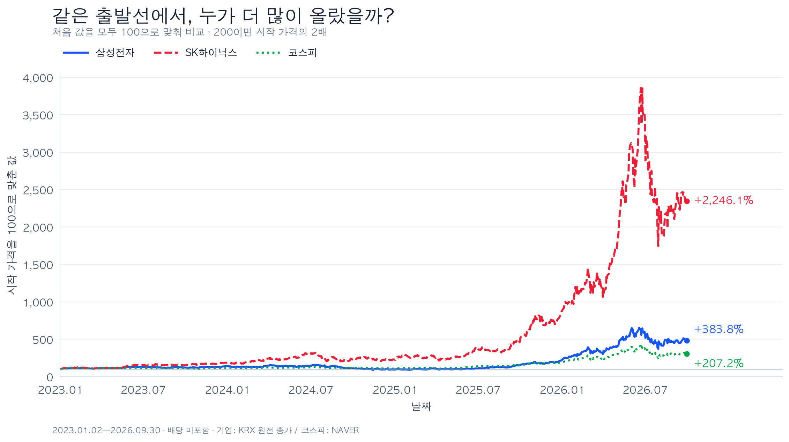
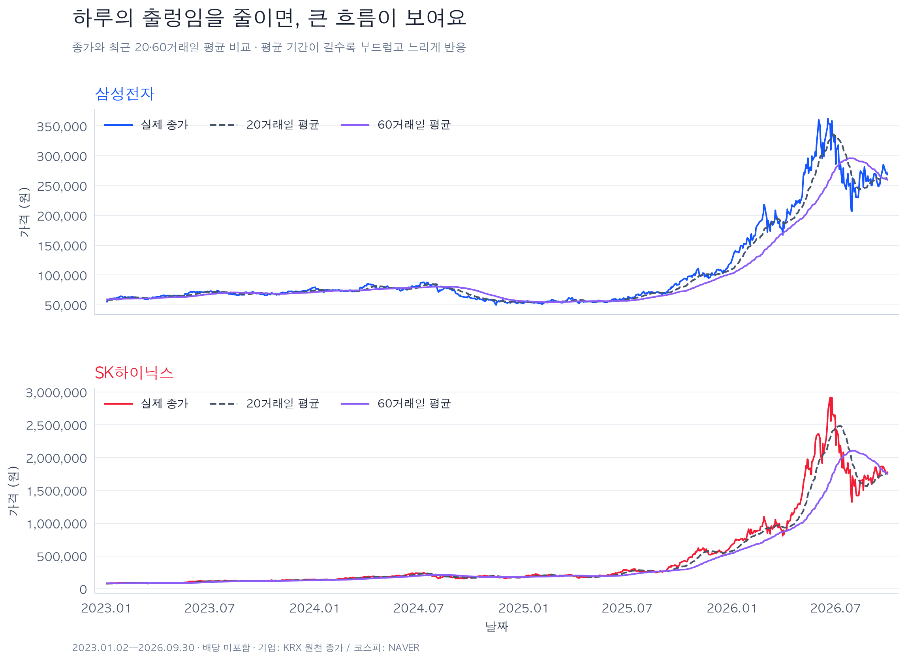
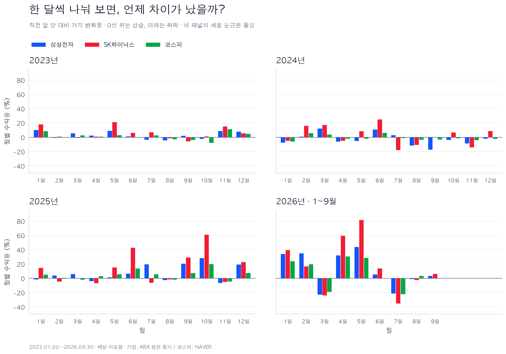
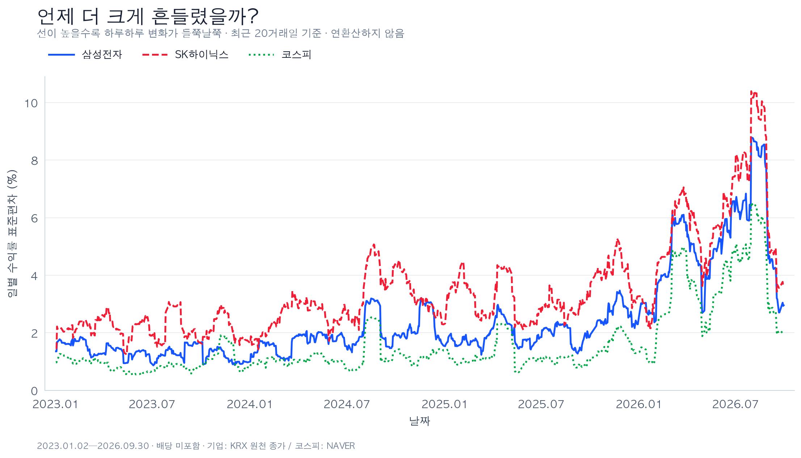
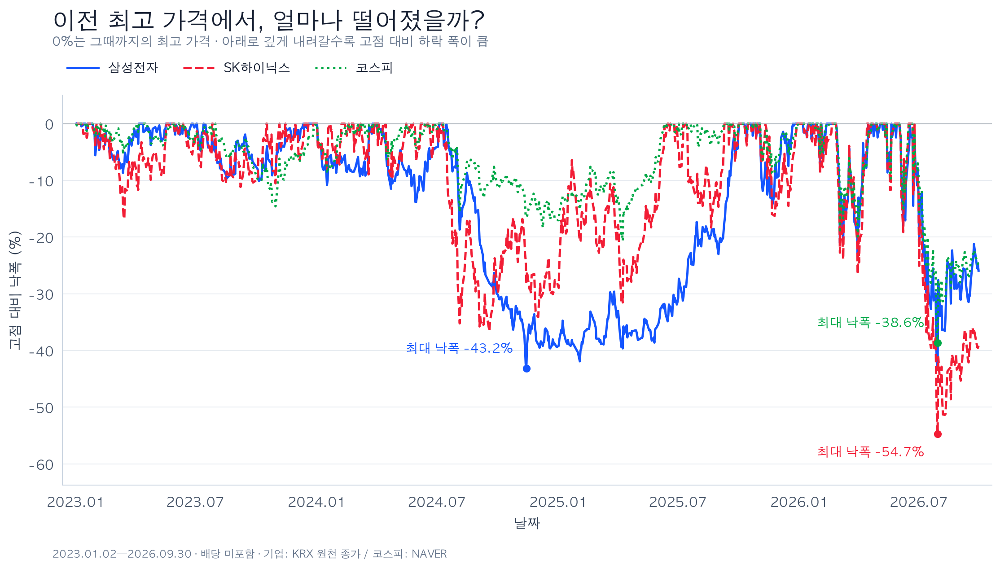

# 삼성전자와 SK하이닉스, 코스피와 비교하면 어떻게 달랐을까?

> 분석 기간: 2023-01-02~2026-09-30 · 작성일: 2026-10-27
>
> 데이터 계산·시각화·리포트 작성을 완료하고 작성자가 핵심 발견 세 가지를 자기 말로 설명했다. 공개본에는 원본 가격 시계열 대신 수집 방법을 제공한다.

## 1. 분석 요약

삼성전자와 SK하이닉스의 일별 종가를 코스피와 비교했다. 전체 기간의 가격 상승률은 SK하이닉스 +2,246.1%, 삼성전자 +383.8%, 코스피 +207.2%였다. 그러나 SK하이닉스는 분석 기간 중 이전 고점 대비 최대 54.7% 하락하기도 했다. 높은 전체 상승률만으로 중간의 하락과 흔들림까지 설명할 수는 없다.

2026년 7월에는 세 대상의 월별 수익률이 모두 음수였고 SK하이닉스의 하락 폭이 가장 컸다. 한편 2024년 연간 수익률은 삼성전자와 코스피가 음수, SK하이닉스가 양수였다. 두 기업의 가격 방향은 항상 같지 않았으며, 시장 흐름과 함께 비교할 필요가 있었다.

## 2. 주제와 분석 질문

목적은 두 기업의 과거 가격 흐름을 같은 기준으로 비교하고, 상승 정도와 그 과정의 흔들림·하락 폭을 수치로 설명하는 것이다. 코스피는 시장의 전반적인 흐름을 비교하는 기준으로 사용했다.

1. 전체 기간에 두 기업은 코스피보다 얼마나 더 오르거나 떨어졌는가?
2. 두 기업과 코스피는 언제 함께 움직였고, 언제 방향이 달랐는가?
3. 어느 대상이 더 크게 흔들렸고, 이전 최고 가격에서 얼마나 하락했는가?

## 3. 데이터와 출처

| 항목 | 내용 |
|---|---|
| 대상 | 삼성전자 보통주(005930), SK하이닉스(000660), 코스피 |
| 실제 분석 구간 | 2023-01-02~2026-09-30, 각 913거래일 |
| 계산 준비 구간 | 2022-07-01~2022-12-29, 각 125거래일 |
| 원본 보관 구간 | 각 1,038거래일, OHLCV 자료 |
| 분석 변수 | 일별 종가. 기업 가격 단위는 원, 코스피 단위는 포인트 |
| 최초 자료 수집 | 2026-10-26, NAVER Finance 일별 응답 보관 |
| 최종 기업 종가 | KRX 원천 시세의 FinanceData/marcap 보관본 |
| 최종 코스피 | NAVER 제공 지수 종가, Yahoo 제공 값과 추가 대조 |
| 가격 기준 | 추가 가격 조정·배당 재투자 없이 선택한 종가 사용 |

기업 자료는 [FinanceData/marcap](https://github.com/FinanceData/marcap)의 커밋 `9d890e304238340a9d40a08e680e276c8d80ceab`으로 고정했다. 최초 수집 URL·시각·원본 해시는 [수집 명세](data/manifest.json)에, KRX 보관본의 파일 해시·가격 대조 결과는 [대조 기록](results/krx_comparison.json)에 보관했다.

자료 선택과 정제는 다음 순서로 수행했다.

1. 원본의 빈칸·중복·비정상 값·종가 범위 등을 검사했다.
2. 제공처 간 종가를 추가 대조했다. NAVER와 Yahoo가 다른 날이 있어 KRX 원천 보관본을 추가 확인했다.
3. KRX 보관본과 다른 NAVER 종가는 삼성전자 9건, SK하이닉스 11건이었다. 두 기업 모두 KRX 원천 종가를 분석 기준으로 선택했다.
4. NAVER 원본 파일은 보존하고, 분석용 자료만 따로 생성했다. 제공처 차이의 발생 원인은 확정하지 않았다.
5. 별도 거래일 달력의 휴장 예외 두 건을 공지로 확인한 뒤 반영했다. 이후 세 대상의 날짜 집합이 일치했다. 휴장일에 가격을 임의로 채우지 않았다.

분석에 사용하는 종가에서 결측이나 중복은 발견하지 못해 보간·중복 제거를 적용하지 않았다. 가격 변화가 크다는 이유만으로 관측을 삭제하지 않았으며, 급등락은 제공처 대조와 기본 가격 관계 검사를 거쳐 유지했다.

예를 들어 2026-09-30의 삼성전자·하이닉스 종가는 원본 NAVER의 269,500원·1,783,000원에서 분석 기준의 268,500원·1,776,000원으로 달라졌다. 따라서 아래 결과는 최초 원본에서 직접 읽은 값으로 계산한 결과와 일부 다르다.

자세한 처리 근거와 가격 정책의 확인 범위는 [데이터 정제 기록](results/data_preparation.md), 변경된 20건은 [가격 차이 목록](results/source_differences.csv)을 참조한다.

## 4. 분석 방법

| 방법 | 계산 기준 | 사용하는 이유 |
|---|---|---|
| 시작값 100 비교 | 해당일 종가 ÷ 2023-01-02 종가 × 100 | 서로 다른 가격·단위를 같은 출발선에서 비교 |
| 전체 기간 가격 수익률 | (마지막 종가 ÷ 첫 분석일 종가 − 1) × 100 | 시작부터 끝까지 얼마나 변했는지 확인 |
| 이동평균 | 당일을 포함한 최근 20·60거래일 종가 평균 | 하루의 출렁임을 줄여 큰 흐름 확인 |
| 월별 가격 수익률 | (해당 월 마지막 종가 ÷ 직전 월 마지막 종가 − 1) × 100 | 함께 오르거나 하락한 달과 차이가 큰 달 확인 |
| 20거래일 변동성 | 최근 20개 일별 수익률의 표본 표준편차 × 100 | 하루하루 변화율의 흩어진 정도 비교 |
| 고점 대비 낙폭 | (당일 종가 ÷ 분석 시작 이후 해당일까지 최고 종가 − 1) × 100 | 이전 최고 가격에서 얼마나 하락했는지 확인 |

일별 수익률은 당일 종가를 직전 거래일 종가와 비교한다. 이동평균과 월별 수익률은 준비 구간을 먼저 포함해 계산하고 실제 분석 구간만 표시했다. 2023년 1월의 월 수익률에는 2022년 12월 말 종가가 기준으로 들어간다.

전체 기간 수익률의 기준은 2023-01-02 종가이며, 연도별 수익률의 기준은 직전 연도 마지막 거래일 종가다. 두 기준을 구분했다. 변동성 그래프는 연환산하지 않았으며, 월별 수익률을 단순히 더해 전체 기간 수익률로 사용하지 않았다.

트렌드는 비교적 긴 기간의 큰 방향, 노이즈는 큰 흐름 주변의 짧고 불규칙한 출렁임이다. 이동평균은 출렁임을 줄여 흐름을 보는 데 사용했다. 계절성은 일정한 달·요일·주기마다 반복되는 패턴을 말한다. 월별 수익률을 그렸다는 사실만으로 계절성을 확인한 것은 아니며, 이 분석에서는 반복 주기나 계절성을 검증하지 않았다.

## 5. 시각화와 결과

기업별 색상은 삼성전자 파랑, SK하이닉스 빨강, 코스피 초록으로 통일했다. 선 모양도 구분했다. 이동평균 그래프의 회색·보라색은 각각 20·60거래일 평균을 뜻한다.

### 5.1 같은 출발선에서 비교한 가격 흐름



| 대상 | 첫 분석일 종가 | 마지막 종가 | 전체 가격 수익률 | 마지막 비교값(시작=100) |
|---|---:|---:|---:|---:|
| 삼성전자 | 55,500원 | 268,500원 | +383.8% | 483.8 |
| SK하이닉스 | 75,700원 | 1,776,000원 | +2,246.1% | 2,346.1 |
| 코스피 | 2,225.67포인트 | 6,838.04포인트 | +207.2% | 307.2 |

세 대상의 출발값을 100으로 맞췄을 때 SK하이닉스가 가장 높게 끝났다. 두 기업 모두 코스피보다 높은 기간 가격 수익률을 기록했다. 비교값 200은 시작 가격의 두 배, 즉 100% 상승을 의미한다.

### 5.2 20·60거래일 이동평균



20거래일 평균은 60거래일 평균보다 최근 가격 변화에 빠르게 반응한다. 60거래일 평균은 더 긴 구간의 가격이 들어가므로 부드럽고 느리게 움직인다. 두 기업 모두 후반부의 큰 상승과 하락을 평균선에서도 확인할 수 있다. 평균선은 과거 가격을 요약하며 미래 방향을 확정하지 않는다.

### 5.3 월별 가격 수익률



월별 변화를 읽기 쉽도록 2023~2026년을 네 패널로 나눴다. 모든 패널의 세로축 범위는 같다. 막대가 0보다 위면 직전 월 말보다 상승, 아래면 하락이다.

2026년 7월의 월별 수익률은 삼성전자 −21.4%, SK하이닉스 −35.2%, 코스피 −22.2%였다. 세 대상이 함께 하락했으며, SK하이닉스의 하락 폭이 가장 컸다.

### 5.4 최근 20거래일 변동성



선이 높을수록 최근 일별 변화율이 더 들쭉날쭉하다. 상승률이나 그날의 하락률을 뜻하지 않는다. 세 대상 모두 2026년에 변동성이 크게 높아지는 구간이 나타난다. 급등과 급락 모두 변동성을 높일 수 있다.

### 5.5 고점 대비 낙폭



| 대상 | 최대 낙폭 | 해당 고점 날짜 | 해당 저점 날짜 |
|---|---:|---|---|
| 삼성전자 | −43.2% | 2024-07-09 | 2024-11-14 |
| SK하이닉스 | −54.7% | 2026-06-22 | 2026-07-30 |
| 코스피 | −38.6% | 2026-06-22 | 2026-07-30 |

각 대상에서 기간 중 가장 깊었던 낙폭을 구한 것이므로 삼성전자의 최대 낙폭 기간은 다른 두 대상과 다르다. 0%는 그때까지의 최고 종가에 있다는 뜻이다. 낙폭은 매수일 기준 손익과 구분한다.

## 6. 핵심 발견과 질문별 답

### 발견 1. SK하이닉스는 가장 많이 올랐지만 고점에서 가장 크게 하락하기도 했다

- 관찰: SK하이닉스의 전체 가격 수익률은 +2,246.1%로 가장 높았고 최대 낙폭도 −54.7%로 가장 깊었다.
- 해석: 시작과 마지막 가격만 비교하면 중간의 큰 하락을 놓친다. 상승률과 낙폭을 함께 확인해야 과정을 설명할 수 있다.
- 근거: 그래프 ①·⑤와 [요약 지표](results/summary_metrics.csv).
- 작성자 확인: 그래프를 보고 “많이 올랐지만 중간에 크게 떨어지기도 했다”고 직접 설명했다.

### 발견 2. 2026년 7월에는 두 기업과 코스피가 함께 하락했다

- 관찰: 삼성전자 −21.4%, SK하이닉스 −35.2%, 코스피 −22.2%로 모두 음수였고 하이닉스의 하락 폭이 가장 컸다.
- 해석: 이 달의 기업 하락을 볼 때 시장의 동반 하락도 함께 고려할 수 있다. 동시에 하락 폭은 동일하지 않았다.
- 근거: 그래프 ③의 2026년 7월 막대와 [월별 수익률](results/monthly_returns.csv).
- 작성자 확인: 세 막대가 0 아래에 있으며 빨간 하이닉스 막대가 가장 깊다고 직접 관찰했다.
- 원인 가설과 구분: 함께 하락했다는 관찰만으로 코스피가 두 기업의 하락을 일으켰다고 확정할 수 없다.

### 발견 3. 두 기업의 가격 방향이 항상 같지는 않았다

- 관찰: 2024년 연간 가격 수익률은 삼성전자 −32.2%, SK하이닉스 +22.9%, 코스피 −9.6%였다. 연간 기준으로 하이닉스는 상승했지만 삼성전자와 코스피는 하락했다.
- 해석: 같은 기간을 보더라도 두 기업을 하나의 동일한 가격 흐름으로 묶으면 차이를 놓칠 수 있다.
- 근거: 그래프 ①의 2024년 구간과 [연도별 수익률](results/annual_returns.csv). 2023년 마지막 거래일 종가와 2024년 마지막 거래일 종가를 비교했다.
- 작성자 확인: “같은 반도체 회사여도 삼성전자는 떨어지고 하이닉스는 올랐으니까 항상 같이 움직이는 건 아니네”라고 직접 설명했다.
- 원인 가설과 구분: 사업 실적이나 제품 구성이 차이에 영향을 주었을 가능성은 추가 검토 대상이다. 이 분석은 공시·실적 자료를 결합하지 않았으므로 원인으로 확정하지 않는다.

질문 1에는 시작값 100 비교와 전체 수익률로, 질문 2에는 월별·연도별 변화로, 질문 3에는 변동성과 최대 낙폭으로 답했다.

## 7. 결론

이 분석 기간에는 두 기업 모두 코스피보다 높은 전체 가격 수익률을 기록했다. 그러나 가장 많이 오른 SK하이닉스는 이전 고점 대비 최대 낙폭도 가장 컸다. 2026년 7월에는 세 대상이 함께 하락했고, 2024년 연간 기준으로는 두 기업의 방향이 달랐다.

따라서 가격 흐름을 설명할 때에는 전체 상승률, 구간별 방향, 흔들림과 낙폭을 함께 확인하는 것이 유용하다. 다음 분석에서는 기간을 나눠 같은 결과가 유지되는지 확인하고, 공시·실적 같은 외부 자료를 추가해 차이의 원인 가설을 검토할 수 있다.

## 8. 한계와 추가로 확인할 점

- 선택한 2023년~2026년 9월 구간의 결과다. 분석 시작일이나 종료일을 바꾸면 수익률·낙폭이 달라질 수 있다. 2026년은 1~9월만 포함한다.
- 가격 변화만 분석했다. 배당·수수료·세금과 실제 매수·매도 조건을 포함한 개인의 투자 손익은 계산하지 않았다.
- 제공처 대조로 차이를 확인하고 기준을 선택했지만, 제공처 차이의 원인과 모든 수정주가 정책을 완전히 확인한 것은 아니다.
- 두 기업과 코스피를 비교했으므로 전체 반도체 기업의 특성으로 일반화하지 않는다.
- 함께 움직인 시점과 크기는 관찰했지만 인과관계를 검증하지 않았다. 뉴스·공시·실적을 결합한 원인 분석이나 미래 예측은 수행하지 않았다.
- 원본 시세의 공개 접근 가능성과 재배포 허용 여부는 별개다. 공개 저장소에는 원본 응답과 전체 일별 시계열을 제외하고 수집 코드·방법과 요약 결과를 제공한다.

## 9. 실행과 검증

### 환경 준비

분석은 Python 3.12.14에서 검증했다. 필요한 라이브러리 버전은 [requirements.txt](requirements.txt)에 고정했다.

```bash
python3.12 -m venv .venv
.venv/bin/python -m pip install -r requirements.txt
```

### 공개본의 첫 수집과 재현

공개 저장소를 처음 받은 환경에는 원본 입력이 없으므로 인터넷에 연결해 다음 명령을 실행한다.

```bash
.venv/bin/python src/reproduce.py --collect
```

데이터 수집, 출처·달력 대조, 기본 검사, 분석을 순서대로 수행한다. 처음에는 KRX 연도별 자료 약 118MB를 내려받는다. 데이터 제공처 변경이나 접근 제한으로 재수집 결과가 달라지거나 실행이 중단될 수 있다. 고정한 KRX 커밋과 수집 당시 해시는 별도로 기록했다.

### 보관 자료로 검사·그래프 재생성

프로젝트 최상위 폴더에서 실행한다.

```bash
.venv/bin/python src/check_data.py
.venv/bin/python src/analyze.py
```

보관된 입력으로 분석 자료·지표·그래프 5개를 다시 만들며 이 단계는 인터넷 연결이 필요 없다. `.venv`가 이미 준비된 현재 작업 환경에서는 환경 설치를 반복할 필요가 없다.

이는 로컬 보관본 또는 앞선 수집 단계가 완료된 환경에 해당한다. 공개 저장소에 원본 입력이 함께 올라가 있다는 의미는 아니다.

수집 원본에서 CSV를 재생성하거나 추가 제공처 대조를 재실행하는 방법은 [README](README.md)에 구분해 기록했다. KRX 전체 연도별 파일 캐시가 없을 때 추가 대조 코드는 약 118MB를 다운로드한다.

### 수행한 검증

- 원본 세 자료의 기본 검사 통과: [검사 결과](results/data_quality.md).
- 제공처 간 가격 및 날짜 대조, 거래일 달력 예외 확인: [정제 기록](results/data_preparation.md).
- 전체 기간 수익률·시작값 100·월별 수익률·최대 낙폭 등의 독립 재계산과 원본 해시 확인: [분석 검증 기록](results/analysis_validation.json).
- 생성한 다섯 그래프를 직접 열어 한글·색상·축·범례·주요 수치·잘림 확인.
- 색상과 배치를 수정한 뒤 원본 CSV 3개·분석 데이터·수익률·요약 지표 파일 총 7개의 SHA-256이 수정 전과 같은지 확인.
- 공개 후보 복사본에서 원본 입력을 제외한 뒤 `src/reproduce.py --collect`를 실행했다. NAVER·Yahoo 응답을 새로 수집하고, KRX 연도별 파일은 고정 커밋의 로컬 캐시를 해시 검증해 재사용했다. 원본 CSV 3개와 결과표 5개가 기존 분석과 일치했다. 같은 Python 환경을 사용했으며 결과는 [공개본 재현 점검](results/public_reproduction_validation.json)에 기록했다.

## 10. AI 사용 로그와 작성자 참여

Codex는 반복 수집, 검사 코드, 제공처 대조, 계산·그래프 코드와 보고서 초안 작성을 보조했다. 작업별 사용 이유와 검증 내역은 [AI 사용·검증 기록](results/AI_USAGE_LOG.md)에 있다.

| AI 사용 작업 | 사용 이유 | 실제 검증 방법 |
|---|---|---|
| 자료 수집·전처리 코드 | 반복 작업 자동화와 출처 보관 | 원본 응답·해시 보관, 날짜·행 수 확인, 제공처 대조와 거래일 확인 |
| 계산·시각화 코드 | 수익률·이동평균·변동성·낙폭 계산과 그림 제작 | 독립 재계산, 원본 해시 대조, 생성한 다섯 그림의 한글·축·범례·색상 확인 |
| 해석 후보와 쉬운 설명 | 작성자가 수치를 이해하고 설명할 수 있도록 보조 | 작성자가 평균선 반응과 핵심 발견 세 가지를 직접 관찰·설명, 확인하지 않은 원인은 가설로 구분 |
| 리포트 초안·문장 정리 | 질문·근거·해석·한계와 재현 방법을 연결 | 결과 파일과 문장 속 수치 대조, 문서의 파일·그림 링크 확인 |

작성자는 원본의 시작·마지막 가격과 날짜·행 수를 직접 확인하고 Excel 기본 검사와 VS Code의 Python 검사 실행을 수행했다. 이동평균 기간을 바꿔 반응 속도를 관찰했고, 전체 상승률·최대 낙폭, 2026년 7월의 동반 하락, 2024년 두 기업의 방향 차이를 자기 말로 설명했다. 코드 작성·계산·문서 정리에 AI를 사용했음을 구분해 기록하며, 작성자가 코드를 모두 직접 작성했다고 표현하지 않는다.

주제 구성에는 [참고 프로젝트](https://github.com/Sungtae10/codyssey-semiconductor-trend-analysis-M1-1/blob/main/REPORT.md)가 제시되었다. 이 보고서의 수치·그림·설명은 이 프로젝트에서 보관·선택한 자료와 계산 결과를 근거로 작성했다.
